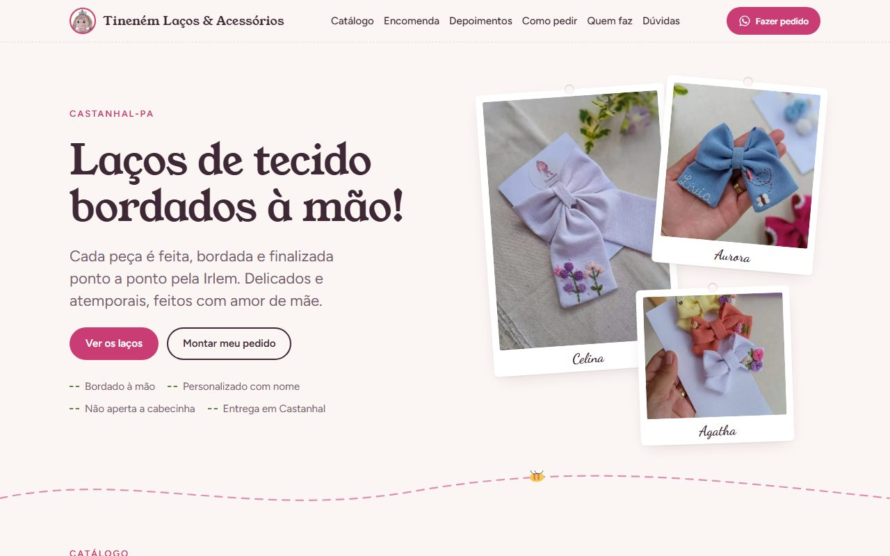

# Tineném Laços & Acessórios

Landing page da **Tineném Laços & Acessórios**, ateliê de laços de tecido bordados à mão em Castanhal-PA.
A página apresenta o catálogo e leva a cliente direto para o WhatsApp com o pedido já escrito.

**Site no ar:** https://willian837.github.io/tinenemlacos/



## Funcionalidades

- **Catálogo** com 12 modelos, filtros (laços, duplas e kits, faixas e tiaras, com nome bordado) e botão "Quero esse" em cada produto
- **Zoom nas fotos:** toque na foto para ver o bordado em detalhe, com botão de pedido
- **Monte seu pedido:** formulário com nome, modelo, acabamento, cor, ocasião e detalhes que abre o WhatsApp com a mensagem organizada
- **Depoimentos** de clientes em formato de conversa, sem dados pessoais
- **Prazo, entrega e pagamento** em destaque
- **Perguntas frequentes:** idade, bebês com pouco cabelo, entrega e cuidados com os laços
- Layout para celular e computador, com botão fixo de pedido no celular
- Favicon e ícones de app feitos a partir da logo; fotos otimizadas em WebP

## Tecnologias

HTML, CSS e JavaScript puros, sem framework e sem etapa de build. Hospedagem no GitHub Pages.
Fontes do Google Fonts: Young Serif, Figtree e Dancing Script.

## Estrutura

```
├── index.html         estrutura e textos da página
├── css/estilo.css     cores, fontes e layout
├── js/dados.js        WhatsApp e lista de produtos
├── js/main.js         catálogo, filtros e montagem do pedido
├── img/produtos/      fotos dos laços (.webp, 560 px de largura)
├── img/marca/         logo usada no topo
├── icones/            ícones de app (Android e iPhone)
├── favicon.ico
└── site.webmanifest
```

## Como editar

| Quero mudar… | Onde |
|---|---|
| Adicionar ou editar um produto | `js/dados.js` + foto em `img/produtos/` |
| Número do WhatsApp | `js/dados.js` (constante `WHATSAPP`) |
| Textos, depoimentos, prazos | `index.html` |
| Cores e fontes | `css/estilo.css` (variáveis no `:root`) |

**Novo produto:** salve a foto em WebP com 560 px de largura em `img/produtos/` e adicione um bloco em `js/dados.js`:

```js
{ nome: "Laço Flor", tam: "TM P", cat: ["laco"], img: "laco-flor.webp",
  desc: "Descrição curta do laço." },
```

`cat` aceita `"laco"`, `"kit"` ou `"faixa"`. Para mostrar um nome bordado no selo da foto, inclua `nomeBordado: "Nome"`. O modelo aparece sozinho na lista do formulário de pedido.

## Rodar localmente

Abra o `index.html` no navegador. Não precisa instalar nada.

---

Feito por [WillTech Automações e Serviços em TI](https://willtech-fog6.onrender.com/).
Fotos, logo e marca Tineném pertencem à Tineném Laços.
